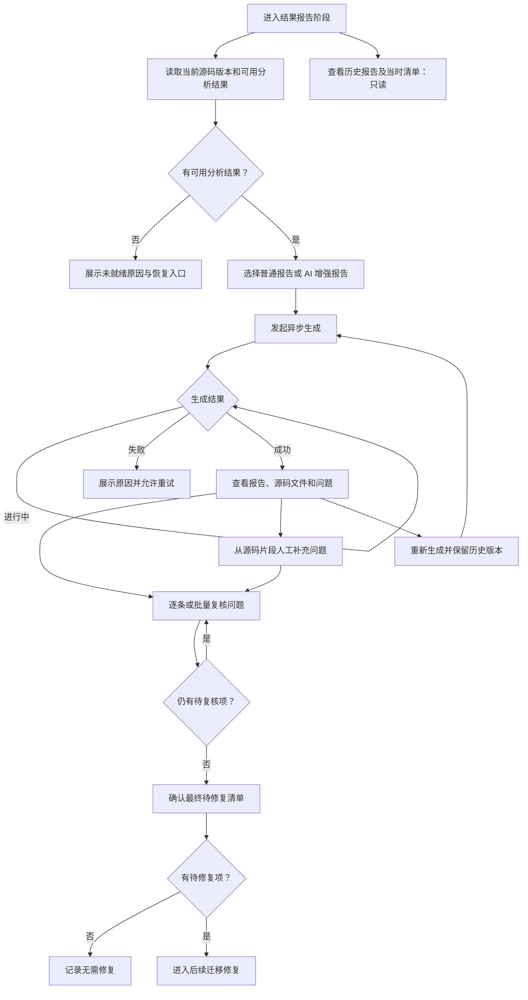

# 结果报告业务需求基线

> 后续确认（2026-11-17）：下方保留前端原文。第 3.3.1、3.4.4 节及验收表中的新问题默认状态以本 change 的草稿规范为准。AI 确认存在问题默认待修复，疑似误报、证据不足及普通报告默认待复核；可靠的人工决定优先，最终清单由用户手动提交。

> 状态：结果报告业务需求基线，供后端实现设计及前端后续开发、联调使用。本文规定用户可观察的行为和数据语义；接口路径、表结构、任务实现及字段命名由后端提出契约，前后端评审后固定。若实现方案无法满足本文某项规则，应先提出差异并修改基线，不以既有代码行为代替需求。

## 1. 目标与范围

用户基于项目当前源码版本和已完成的分析结果生成评估报告，在报告中查看问题及源码依据，复核并确认最终待修复清单，再进入后续迁移修复流程。历史报告应能独立追溯其生成时的输入和人工决定。

本需求覆盖报告生成、结果阅读、问题复核、人工补充、清单确认、重新生成和历史查看。具体接口、持久化模型、任务调度及与现有能力的复用方式由后端评估后提出方案。

本文将“报告”指生成任务产出的分析结论和输入快照；“复核草稿”指用户对报告问题作出的加入待修复、排除和人工补充决定；“最终清单”指用户确认后供后续修复使用的复核结果。旧规范中的“纳入报告”是生成前选择报告输入，与本需求生成后“加入待修复清单”不是同一个操作。本流程采用先生成报告、再复核问题和确认清单的顺序。报告原始结论和已确认清单不可被草稿修改静默覆盖。

### 已确定的业务规则

- 当前源码版本下，知识库扫描、依赖分析、浮点精度分析、强弱内存序分析中任意一项有**成功完成的有效运行**，即可生成报告。成功运行即使产生零个问题也满足条件，可生成零问题报告；没有当前源码版本时不能生成。
- AI 增强模式在项目模型配置可用时默认选中；配置不可用时默认选中普通报告，并提供配置入口。AI 任务失败不自动改用普通模式，用户可明确选择后重新生成。
- 新出现的问题默认“待复核”；AI 的判断是建议，不能自动替用户确认问题或最终清单。只要仍有待复核项，服务端和页面都不得确认最终清单。
- 重新生成按第 3.4 节有条件继承人工决定，但新报告的最终清单始终需要重新确认。

## 2. 业务流程

## 3. 功能需求

### 3.1 生成前

1. 系统明确展示本次使用的项目、源码版本、已完成的分析来源及其可用状态。
2. 按“已确定的业务规则”判断生成资格。不满足条件时展示缺少当前源码、分析未完成等具体原因和可执行的恢复入口；零问题的成功分析不应被误判为未完成。
3. 用户可选择普通或 AI 增强模式。AI 增强需要可用的项目模型配置；缺少配置时说明原因并引导配置，不阻止用户选择普通报告。
4. 生成操作应防止重复点击产生多个无法区分的任务；任务的排队、运行、成功、失败状态及失败原因均可查询。页面刷新后能恢复当前任务状态。
5. 报告生成时固定本次使用的源码版本、各分析运行及问题输入。生成期间分析结果或当前源码发生变化，不得把新旧数据混入同一报告。

#### AI 增强的默认复核输入

AI 增强复核的是报告输入候选，不等于把问题自动加入最终待修复清单。默认纳入当前项目、当前源码版本下已完成分析的最新有效问题：

| 来源 | 默认进入 AI 复核的内容 |
| --- | --- |
| 知识库扫描 | 本次有效扫描产生的 Finding，包含低风险和待人工核对项。 |
| 依赖分析 | 目标侧未满足、存在迁移风险或需要替代处理的依赖问题；正常匹配且无需处理的依赖不作为问题输入。 |
| 浮点精度分析 | 本次有效分析产生的 Finding。 |
| 强弱内存序分析 | 本次有效分析产生的正式 Finding 和待核实候选；候选始终标明待核实，不因 AI 判断或人工选择变成正式风险。 |

其他源码版本、非当前有效运行、已失效或已被新结果替代的问题不属于本次报告输入。用户此前明确排除的问题保留在可追溯的复核记录中，但默认不再提交 AI 复核；重新生成时按第 3.4 节判断能否继承其“已排除”决定。跨来源重复发现可合并展示，但必须保留每条原始来源与证据，不得丢失问题。生成前展示各来源的候选数量、排除数量和实际提交 AI 的数量，便于核对输入。AI 可以提出疑似误报、依据不足和处理建议，但不能代替用户确认问题或最终清单。普通报告同样基于当前有效分析结果生成，但不执行 AI 复核。

### 3.2 报告阅读

1. 报告展示生成时间、生成方式、绑定的源码版本、分析输入来源、总体结论及各类问题数量。所有数量以服务端保存的报告事实为准。
2. 用户可以按文件查找源码与问题，搜索文件名或路径；选择问题后定位到对应源码行或片段，并查看原始发现、复核依据和建议。
3. 问题列表支持搜索与状态筛选；报告中的依赖问题、内存序待核实项等不同来源保留各自语义，不把待核实项直接升级为确定风险。
4. 源码不可用时保留问题记录，说明无法展示源码的原因。
5. 当前报告的复核入口以文件和源码为主要工作区，用户能从问题定位到绑定版本的源码；依赖类问题无源码位置时提供对应的依赖证据。报告历史可沿用已有的模块—文件—Finding 阅读路径。
6. 报告保留 HTML 和 JSON 下载能力。下载的是后端保存的该报告版本，不由前端用当前数据重新拼装。
7. AI 增强报告应逐项保留 AI 复核建议（例如支持、疑似误报或依据不足）及其依据，并标明与原始分析结论的区别。若 AI 复核未完整成功，该任务不得以“AI 增强报告成功”呈现；失败原因可见，用户可主动重试或另选普通模式。

### 3.3 问题复核与清单

1. 当前报告的每个需决策问题恰有一个复核状态：“待修复”“待复核”或“已排除”。新问题默认待复核；用户可逐条或批量改为待修复或已排除，操作结果同步更新列表、详情与统计。AI 建议单独展示，不直接改变人工复核状态。
2. 用户可选中当前报告绑定源码中的片段，填写问题描述及修复原因，人工补充待修复项；人工补充项应标明来源并可移除。
3. 复核修改需要持久化。刷新页面或重新进入阶段后，用户应看到同一报告的最新草稿，不能只保存在浏览器本地。
4. 仍有待复核项时，服务端拒绝确认最终清单，页面显示待处理数量并引导用户继续复核。全部问题处理完毕后，用户确认形成该报告的最终待修复清单快照。清单允许为空，表示本次无需修复；后续阶段仅依据当前已确认清单判断是否需要处理，不能依据问题总数或浏览器本地状态推断。
5. 已确认清单再次发生修改时，不得静默改写原快照；当前复核结果须重新确认，先前确认记录保留供追溯。
6. 确认与草稿修改要避免覆盖并发变更：若用户基于旧草稿确认或更新，系统提示冲突并要求刷新后重试，而不是产生与页面所见不一致的清单。

### 3.4 重新生成与历史

1. 用户可以重新生成报告。旧报告、其输入和最终清单保持可追溯，不被新报告覆盖。
2. 历史报告按生成时绑定的源码版本、分析输入、问题和清单展示，不借用当前项目数据重算；历史内容只读。
3. 当前源码版本变化后，旧报告和旧清单变为历史只读，不得作为新源码版本的修复依据；新报告须基于新版本重新生成。
4. 重新生成时继承人工决定：仅当新旧报告绑定同一源码版本，且能可靠判定为同一问题、问题依据与位置未发生实质变化时，沿用旧报告中的“待修复”或“已排除”决定；新增或实质变化的问题回到“待复核”。人工补充项仅在其源码片段仍可定位时继承。不能可靠匹配时不继承，并说明原因。继承结果需向用户标明来源，新报告的最终清单仍须重新确认。具体匹配规则由后端设计并在接口契约中说明。
5. 重新生成成功后，上一版报告和草稿转为历史只读；当前草稿属于新报告。生成失败不应替换仍有效的当前报告及草稿。

## 4. 关键数据与状态

后端方案需要支持前端识别以下业务事实，字段名称由接口设计确定：

- 当前项目与源码版本；四类分析来源的运行 ID、完成状态、结果版本、问题数和生成资格及原因。
- 报告 ID、绑定的源码与分析运行、生成方式及使用的模型配置版本、任务 ID、任务状态、失败原因、生成时间和不可变的输入快照。
- 文件路径、绑定版本的源码内容或可读取区间、问题位置、原始发现、AI 建议、复核依据、风险语义及原始来源；依赖问题无源码位置时的证据。
- 每个问题的稳定身份或匹配依据、人工复核状态、人工补充内容、草稿版本、继承来源和未继承原因。
- 确认状态、待复核数、最终清单快照及其版本；零项确认与未确认必须可区分。
- 当前、过期和历史报告的判定；历史报告与清单的版本；后续修复阶段使用的当前已确认清单。

前端展示的业务说明按项目规范提供中文和英文字段；代码标识和技术枚举可以保留英文。

列表数据量可能超过单页。接口契约应明确分页、搜索、筛选、排序、空列表、缺失源码、旧版本和并发冲突的响应语义；前端不得靠截取第一页或本地存储推算完整清单。

## 5. 验收场景

| 场景 | 预期结果 |
| --- | --- |
| 当前源码没有可用分析结果 | 不允许生成，展示原因及恢复入口；历史报告仍可查看。 |
| 四类分析中只有一项在当前源码版本下成功完成 | 允许生成，报告记录实际使用的分析运行；其余未完成来源不伪装成已分析。 |
| 唯一成功分析产生零个问题 | 允许生成零问题报告；无待复核项时可确认空清单，表示无需修复。 |
| AI 配置不可用 | AI 增强不可提交且有配置引导；普通报告可正常提交。 |
| AI 增强生成报告 | 默认复核当前有效分析的问题，来源和数量可核对；历史、失效和用户已排除的问题不进入本次 AI 输入。 |
| AI 发现疑似误报或内存序候选 | 展示建议或待核实提示，不自动确认清单，也不将待核实候选升级为正式风险。 |
| AI 复核部分失败 | 不呈现为成功的 AI 增强报告；显示失败信息，用户可主动重试或选择普通报告。 |
| 生成任务失败或页面刷新 | 可恢复任务状态并查看失败原因；失败不替换原有效报告，也不自动切换生成模式。 |
| 生成过程中源码或分析结果改变 | 已发起报告仍使用提交时固定的输入；完成后若不是当前 Context，标记为历史，不用于当前清单。 |
| 排除误报、加入待修复项或批量操作 | 列表、详情和统计一致；刷新后结果仍在。 |
| 从源码补充问题 | 补充项与报告源码版本绑定，标识人工来源，允许移除。 |
| 仍有待复核项，或基于旧草稿提交确认 | 服务端拒绝确认；前端分别展示待处理数量或并发冲突，不产生已确认清单。 |
| 确认零条待修复项 | 保存“无需修复”的已确认结果，后续流程不要求进入修复。 |
| 确认后再次修改 | 当前清单变为待确认；此前的确认记录可追溯。 |
| 重新生成报告 | 相同且未变化的问题沿用人工决定；新增或实质变化的问题待复核；新清单须重新确认。 |
| 重新生成后查看旧报告 | 旧报告及当时的输入、源码和清单保持不变且只读。 |
| 当前源码版本变化 | 旧报告和清单转为历史只读，新源码版本必须重新生成报告和确认清单。 |
| 下载历史或当前报告 | 获得所选报告版本的 HTML 或 JSON，不混入当前项目的新数据。 |

## 6. 现有实现差异与开发交接

当前代码与本基线存在以下差异，开发时须评估并消除，不能将旧行为直接视为验收结果：

1. 现行 `assessment-report` 规范和后端报告生成流程使用生成前的 `INCLUDED_FINDINGS` 前置条件；本基线要求先生成、后复核和确认。后端应说明旧逻辑及已有数据如何兼容，前端正式规范随后同步更新。
2. 当前后端的自动汇入默认仅覆盖知识库与依赖分析；本基线的 AI 候选范围还包括浮点与内存序 Finding，并保留待核实语义。
3. 当前后端报告生成请求尚未消费 AI 模式；现有前端结果报告工作台主要使用模拟数据和浏览器本地状态，且模拟确认操作尚未阻止待复核项。两端需要按本基线替换这些行为。

后端开始实现前，先提交一份可评审方案：现有能力复用与缺口、四类来源的“当前有效运行”和依赖需处理项判定、跨来源去重与同一问题匹配规则、报告与复核草稿及确认快照的版本关系、任务和并发处理、后续修复阶段取数方式。方案可以选择不同技术实现，但应逐项映射到第 3 至 5 节的行为。

后端完成后提供固定的接口契约（请求与响应示例、枚举、分页筛选、错误码、任务更新方式、权限与 Context 校验）及覆盖第 5 节的联调数据。前端据此替换模拟工作台、接入报告和清单状态，并用相同场景验收；接口或业务规则变更先同步本文和契约，再修改两端代码。
